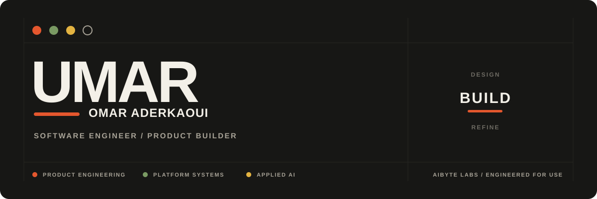

  

  
  
  
  

<table>
  <tr>
    <td width="63%" valign="top">
      <h2>Good software should explain itself.</h2>
      
I’m <strong>Omar Aderkaoui</strong>, a software engineer, technical consultant, and founder of <a href="https://aibytelabs.com"><strong>AIByte Labs</strong></a>.

      
I spend most of my time building products where the UI/UX and the underlying systems have to work well together. That usually means complex workflows, integrations, internal tools, and AI features that actually earn their place.

      
I care a lot about the small things that make software feel good to use: clear feedback, sensible defaults, useful error messages, good naming, and making sure people always know what is happening.

    </td>
    <td width="37%" valign="top">
      <h3>NOW / 2026</h3>
      
<code>BASE</code>&nbsp;&nbsp;&nbsp;&nbsp;&nbsp;&nbsp;&nbsp;&nbsp;&nbsp;Morocco

      
<code>ROLE</code>&nbsp;&nbsp;&nbsp;&nbsp;&nbsp;&nbsp;&nbsp;&nbsp;&nbsp;Founder &amp; engineer

      
<code>FOCUS</code>&nbsp;&nbsp;&nbsp;&nbsp;&nbsp;&nbsp;&nbsp;Product systems

      
<code>DEFAULT</code>&nbsp;&nbsp;&nbsp;TypeScript

      
<code>MODE</code>&nbsp;&nbsp;&nbsp;&nbsp;&nbsp;&nbsp;&nbsp;&nbsp;&nbsp;&nbsp;Design → Build → Refine

      
<code>STANDARD</code>&nbsp;Engineered for use

    </td>
  </tr>
</table>
<h2>The workbench</h2>
<table>
  <tr>
    <td width="33%" valign="top">
      INTERFACE
      <h3>Things people see and use</h3>
      
React, Next.js, TypeScript, Tailwind CSS, design systems, and the small interaction details that make an interface feel finished.

    </td>
    <td width="33%" valign="top">
      SYSTEM
      <h3>Things behind the UI</h3>
      
Node.js, Hono, Zod, APIs, integrations, and backend systems that stay understandable as the product gets bigger.

    </td>
    <td width="34%" valign="top">
      WORKFLOW
      <h3>Things I use every day</h3>
      
pnpm, Git, GitHub, Figma, Cloudflare, testing, debugging, and enough documentation that I do not hate myself six months later.

    </td>
  </tr>
</table>

  

  
  
  

 
<h2>Operating principles</h2>
<table>
  <tr>
    <td width="50%" valign="top">
      01
      <h3>Make the next step clear.</h3>
      
People should not have to stop and figure out what the interface wants from them. The important action should be easy to spot.

    </td>
    <td width="50%" valign="top">
      02
      <h3>Do not add complexity for fun.</h3>
      
Every dependency, abstraction, setting, and extra screen becomes something you have to understand and maintain later.

    </td>
  </tr>
  <tr>
    <td width="50%" valign="top">
      03
      <h3>Think about what happens when it breaks.</h3>
      
The happy path is the easy part. Good software tells you what went wrong, keeps your work safe, and gives you somewhere to go next.

    </td>
    <td width="50%" valign="top">
      04
      <h3>Leave things easier to understand.</h3>
      
Better names, fewer weird exceptions, clearer boundaries, and less hidden behavior. Small improvements like that add up fast.

    </td>
  </tr>
</table>
 
<h2>GitHub activity</h2>

I don't read too much into GitHub stats, but they're still a nice way to see what I've been building and experimenting with over time.

<picture>
  <source media="(prefers-color-scheme: dark)" srcset="https://github-readme-activity-graph.vercel.app/graph?username=whoElseButUmar&custom_title=Recent%20activity&hide_border=true&bg_color=171715&color=A8A397&line=E4572E&point=F3F0E8&title_color=F3F0E8&area=true&area_color=E4572E">
  <source media="(prefers-color-scheme: light)" srcset="https://github-readme-activity-graph.vercel.app/graph?username=whoElseButUmar&custom_title=Recent%20activity&hide_border=true&bg_color=F1EEE5&color=6F6A61&line=E4572E&point=171715&title_color=171715&area=true&area_color=E4572E">
  
</picture>
<table>
  <tr>
    <td width="50%" valign="top">
      <picture>
        <source media="(prefers-color-scheme: dark)" srcset="https://github-readme-stats.vercel.app/api?username=whoElseButUmar&show_icons=true&hide_border=true&bg_color=171715&title_color=F3F0E8&text_color=A8A397&icon_color=E4572E&ring_color=E4572E">
        <source media="(prefers-color-scheme: light)" srcset="https://github-readme-stats.vercel.app/api?username=whoElseButUmar&show_icons=true&hide_border=true&bg_color=F1EEE5&title_color=171715&text_color=6F6A61&icon_color=E4572E&ring_color=E4572E">
        
      </picture>
    </td>
    <td width="50%" valign="top">
      <picture>
        <source media="(prefers-color-scheme: dark)" srcset="https://github-readme-stats.vercel.app/api/top-langs/?username=whoElseButUmar&layout=compact&hide_border=true&bg_color=171715&title_color=F3F0E8&text_color=A8A397">
        <source media="(prefers-color-scheme: light)" srcset="https://github-readme-stats.vercel.app/api/top-langs/?username=whoElseButUmar&layout=compact&hide_border=true&bg_color=F1EEE5&title_color=171715&text_color=6F6A61">
        
      </picture>
    </td>
  </tr>
</table>
 
<h2>Behind the interface</h2>

  
<strong>What I care about</strong>

   
  
I want people to understand what they are looking at quickly, know what to do next, and trust that the software will behave the way they expect. On the code side, I try to leave things clear enough that someone else can jump in without needing me to explain every decision.

  
<strong>How I think about AI features</strong>

   
  
I usually start with the problem, not the model. If AI is not making the workflow meaningfully easier, it probably does not need to be there. I also like keeping the user in control and being clear about what the system is doing instead of pretending it is always right.

  
<strong>Things I tend to remove</strong>

   
  
Extra settings, unnecessary dashboards, vague labels, abstractions that exist too early, animation for the sake of animation, and features that only exist because somebody else has them.

 
<table>
  <tr>
    <td width="65%" valign="middle">
      <h2>Have something interesting to build?</h2>
      
I work on product engineering, platform integrations, applied AI, and the occasional weird idea that is worth trying.

    </td>
    <td width="35%" valign="middle" align="center">
      <a href="mailto:contact@aibytelabs.com"><strong>contact@aibytelabs.com</strong></a>
        
      <a href="https://aibytelabs.com">aibytelabs.com ↗</a>
    </td>
  </tr>
</table>
 

  

